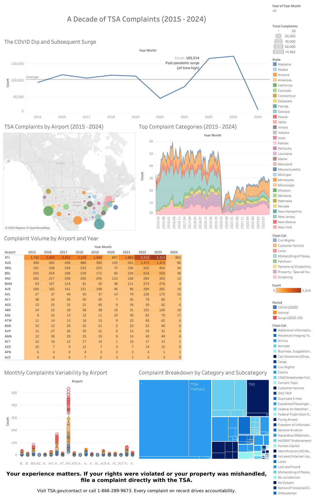

# A Decade of TSA Complaints (2015–2024)

**Are airport security complaints getting better or worse, and where are they coming from?** This interactive Tableau dashboard tells the story of ten years of complaints filed with the Transportation Security Administration, showing how volume changed through COVID-19, which airports generate the most complaints, and what travelers are complaining about.

📊 [Interactive dashboard (Tableau Public)](https://public.tableau.com/app/profile/leo.luera/viz/DSC640Week9and10Assignment-Luera/Dashboard1) · 📄 [Paper](tsa_complaints_writeup.pdf) · 📓 [Notebook](tsa_complaints_data_prep.ipynb)

---

## Key Findings

- **Complaints didn't just recover after COVID-19; they hit record highs.** Annual complaints held at roughly 100,000–117,000 from 2016 to 2019, fell to about 45,000 in 2020 as travel collapsed, then surged past 165,000 in both 2022 and 2023. (2024 includes only part of the year.)
- **Atlanta stands out.** Hartsfield-Jackson (ATL) logged about 1,800–2,400 complaints a year before COVID, then 4,533 in 2022 and 5,314 in 2023, more than double its pre-pandemic level. Its busiest months topped 500 complaints.
- **The surge reached smaller airports too.** Austin (AUS) went from 394 complaints in 2019 to about 1,470 in both 2022 and 2023, nearly four times as many.
- **TSA PreCheck is itself a leading source of complaints.** In the subcategory treemap, PreCheck is one of the largest blocks, meaning the program designed to speed up screening is one of the biggest complaint drivers.
- **What travelers complain about changed after 2020.** Before the pandemic, mishandled passenger property made up a large share of monthly complaints; afterward, customer service complaints dominate.

## Call to Action

Travelers who experience problems at security should file a complaint at [TSA.gov/contact](https://www.tsa.gov/contact) or by phone at 1-866-289-9673. Policymakers can use the dashboard to target reform at the highest-complaint airports and categories.

## Dashboard Design

- **Audience:** Everyday U.S. air travelers who are familiar with security screening but not with complaint data or how to file a complaint.
- **Purpose:** To inform and empower, showing travelers whether their frustrations are shared and where problems concentrate.
- **Medium:** An interactive Tableau dashboard, so viewers can filter by year and explore airports without any data skills.
- **Flow:** The story opens with the ten-year trend line, then grounds it geographically with a bubble map, and then breaks it down by complaint type.

| Visual | What it shows |
|--------|---------------|
| Trend line | Annual complaints, 2015–2024, against the ten-year average |
| Bubble map | Total complaints by airport, sized by volume |
| Stacked area chart | Monthly complaints by category |
| Heatmap | Complaint intensity by airport over time |
| Box plot | Monthly variability by airport, separating consistently high airports from those with seasonal spikes |
| Treemap | Specific complaint subcategories within each category |

## Data

| Dataset | Description |
|---------|-------------|
| `complaints-by-airport.csv` | Monthly complaint counts by airport (41,721 rows) |
| `complaints-by-category.csv` | Monthly counts by airport and complaint category (241,588 rows) |
| `complaints-by-subcategory.csv` | Monthly counts by airport, category, and subcategory (504,512 rows) |
| `iata-icao.csv` | Airport codes, names, and coordinates worldwide (8,937 airports) |

Data was compiled from TSA's public complaint reports. The notebook filters airport codes to the U.S., totals complaints by airport, joins in names and coordinates for mapping, and builds a separate dataset of civil rights and disability-related complaints by airport for equity analysis. The visuals were then built in Tableau.

## Ethical Considerations

Complaint data only reflects travelers who knew how to file and chose to, so people with limited English, lower digital literacy, or distrust of government channels are likely underrepresented, especially in civil rights complaints. Raw counts also favor large airports with more passengers. Airports are named only in aggregate, from official public records, with the goal of systemic accountability rather than blame.

## Tools

Tableau · Python · pandas · Jupyter

---

*Completed May 2026 for DSC 640 (Data Presentation and Visualization).*
